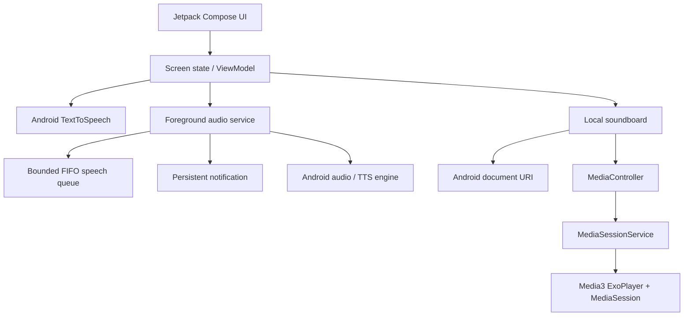

# LiveCreator Studio

<p align="center">
  <a href="https://adebojel.github.io/LiveCreatorStudio/"><strong>🌐 Website Resmi</strong></a> ·
  <a href="https://adebojel.github.io/LiveCreatorStudio/features.html">Fitur</a> ·
  <a href="https://adebojel.github.io/LiveCreatorStudio/download.html">Unduh</a> ·
  <a href="https://adebojel.github.io/LiveCreatorStudio/support.html">Bantuan</a> ·
  <a href="https://adebojel.github.io/LiveCreatorStudio/privacy.html">Privacy Policy</a> ·
  <a href="https://adebojel.github.io/LiveCreatorStudio/terms.html">Terms of Service</a>
</p>

<p align="center">
  
</p>

<p align="center">
  <a href="https://github.com/adebojel/LiveCreatorStudio/actions/workflows/android.yml"></a>
  <a href="https://github.com/adebojel/LiveCreatorStudio/releases"></a>
  
  
  
</p>

<p align="center">
  **Studio pendamping kreator livestream** — dashboard audio, pembacaan teks, dan soundboard lokal dengan fondasi integrasi event yang transparan.
</p>

<p align="center">
  <a href="https://github.com/adebojel/LiveCreatorStudio/releases/latest/download/LiveCreatorStudio-debug.apk"><strong>Unduh APK terbaru</strong></a> ·
  <a href="https://github.com/adebojel/LiveCreatorStudio/releases">Semua Releases</a> ·
  <a href="https://github.com/adebojel/LiveCreatorStudio/actions">Status Build</a>
</p>

---

## Website dan status integrasi

Website proyek: https://adebojel.github.io/LiveCreatorStudio/

- [Fitur](https://adebojel.github.io/LiveCreatorStudio/features.html)
- [Panduan unduhan dan rilis](https://adebojel.github.io/LiveCreatorStudio/download.html)
- [Pusat bantuan](https://adebojel.github.io/LiveCreatorStudio/support.html)
- [Status integrasi TikTok](https://adebojel.github.io/LiveCreatorStudio/integration.html)
- [Kebijakan Privasi](https://adebojel.github.io/LiveCreatorStudio/privacy.html)
- [Ketentuan Layanan](https://adebojel.github.io/LiveCreatorStudio/terms.html)

**Penting:** aplikasi Android belum tersedia di Google Play. APK yang dibangun CI saat ini adalah APK debug untuk pengujian, bukan rilis produksi. Integrasi TikTok resmi (Login Kit/Share Kit) dan konektor LIVE belum aktif. Jangan mengajukan app review Android sebelum persyaratan distribusi toko aplikasi, signing release, implementasi nyata, dan video demo terpenuhi. Lihat [TikTok review readiness](docs/TIKTOK_REVIEW_READINESS.md).


## Status proyek

**Versi sumber: 0.5.8 (dalam pengembangan).** Versi ini menambahkan pustaka soundboard CC0 otomatis: 210 suara awal diunduh saat aplikasi pertama kali dibuka, dengan opsi mengunduh seluruh 10 paket (sekitar 730 aset) dan tetap mendukung impor audio manual.

> **Status APK:** tautan unduhan di atas selalu menunjuk ke release sukses terbaru yang tersedia. APK versi yang tercantum pada halaman Releases adalah build sukses terbaru. APK debug bukan APK produksi bertanda tangan. Build debug bukan APK produksi bertanda tangan.

## Tampilan dan arsitektur

Ilustrasi di bagian atas adalah **gambar konsep dashboard**, bukan screenshot aplikasi atau bukti fitur. Screenshot perangkat yang sebenarnya baru akan ditambahkan setelah pengujian perangkat dilakukan.



## Fitur yang sudah ada di source

- **Dashboard Android** berbasis Kotlin dan Jetpack Compose dengan navigasi Dashboard, TTS, Soundboard, dan Settings.
- **TTS lokal Bahasa Indonesia** menggunakan mesin TextToSpeech perangkat; tersedia preview, pengaturan speech rate dan pitch, penyimpanan preferensi sederhana, tombol stop, serta callback mulai/selesai/error.
- **Antrean TTS latar belakang** berbentuk bounded FIFO dengan kapasitas maksimum 40 permintaan. Ketika penuh, permintaan tertua yang masih menunggu dibuang agar permintaan terbaru tetap masuk.
- **Foreground audio service** yang dimulai oleh pengguna, notifikasi persisten, tindakan hentikan layanan, serta tindakan hapus antrean.
- **Proteksi callback TTS usang** agar callback dari utterance yang telah dibatalkan tidak mengubah status playback baru.
- **Penyimpanan preferensi terpusat** menggunakan Preferences DataStore; pengaturan auto-start, pengingat reboot, speech rate, dan pitch dimigrasikan otomatis dari SharedPreferences lama. Nilai TTS divalidasi sebelum disimpan/dipakai.
- **Playback soundboard menggunakan AndroidX Media3 1.11.1 ExoPlayer** dengan audio focus handling dan penghentian saat audio output eksternal dicabut. Metadata pustaka disimpan di Preferences DataStore dengan migrasi otomatis dari SharedPreferences lama. Playback soundboard menggunakan AndroidX Media3 1.11.1 (rilis stabil) dan berjalan pada MediaSessionService terpisah dari lifecycle Compose. Kontrol sesi tersedia melalui notifikasi media Android, lockscreen, headset, dan perangkat Bluetooth yang kompatibel; koneksi UI dapat dilepas tanpa menghentikan sesi.
- **Soundboard CC0 otomatis**: mengunduh 3 paket awal Kenney (210 suara) pada peluncuran pertama, opsi satu tombol untuk seluruh 10 paket (sekitar 730 aset), ekstraksi aman ke penyimpanan privat, lisensi/sumber per paket, serta playback offline melalui Media3. Impor audio pribadi tetap opsional; tersedia tes speaker tanpa file audio. Lihat [katalog dan lisensi soundboard](docs/SOUND_LIBRARY.md).
- **Picture-in-Picture** untuk panel status ringkas.
- **Kontrak LiveEventProvider** untuk adapter event read-only, status koneksi, dan aliran event terpisah dari UI; belum ada provider runtime yang aktif.
- **Label semantik kontrol** Compose untuk nama tombol dan status yang jelas; aplikasi tidak meminta pengguna mengaktifkan TalkBack.
- **Shortcut Settings** untuk pengaturan notifikasi, info aplikasi/izin, dan optimasi baterai.
- **Auto-start opt-in** ketika pengguna membuka aplikasi dan pengingat reboot opsional; aplikasi tidak memaksa Android menjalankan layanan saat boot.

## Yang belum tersedia — tidak boleh dianggap aktif

| Area | Status saat ini |
|---|---|
| TikTok LIVE real-time event ingestion | Kontrak adapter read-only tersedia; konektor runtime belum terintegrasi |
| Komentar, gift, follow, share, like event processor | Belum tersedia |
| Autentikasi/provider LIVE resmi | Belum tersedia |
| Soundboard otomatis berdasarkan event | Belum tersedia |
| Mixing beberapa kanal audio dan sesi soundboard persisten | Belum tersedia |
| AI cloud provider | Belum tersedia |
| AI lokal GGUF/llama.cpp | Belum terintegrasi |
| Speech-to-text streaming | Belum tersedia |
| Database Room untuk seluruh data aplikasi | Belum tersedia |
| APK release production-signed | Belum tersedia |

Aplikasi tidak membuat event LIVE palsu, tidak mensimulasikan AI, dan tidak menampilkan status provider tersambung jika koneksi nyata belum ada.

## Audit repository eksternal

Kami meninjau sejumlah proyek publik untuk menemukan komponen yang bisa dipelajari dan diadaptasi. Hasil audit, lisensi, risiko, dan rencana integrasinya dicatat di [docs/REPOSITORY_AUDIT.md](docs/REPOSITORY_AUDIT.md).

Kandidat penting:
- [Llamatik](https://github.com/llamatik/Llamatik) — SDK Kotlin untuk inferensi lokal, agent, memori, RAG, dan speech; lisensi MIT untuk kode inti, tetapi memiliki native build dan kebutuhan perangkat yang harus dievaluasi.
- [LocalMind](https://github.com/tk85457/LocalMind) dan [Offline AI Assistant](https://github.com/its-hazratbilal/offline-ai-assistant) — referensi aplikasi Android offline AI, model GGUF, llama.cpp/JNI, manajemen model, dan riwayat lokal; keduanya menyatakan lisensi MIT.
- [Hush AI](https://github.com/hushai-app/hushai-android) dan [On-device LLM](https://github.com/ThalzeronLabs/android-on-device-llm) — alternatif Android lokal berbasis llama.cpp; Apache-2.0, dengan biaya model besar, native build, dan kebutuhan RAM/ARM64 yang perlu diperhitungkan.
- [Parakeet Android](https://github.com/meet30997/parakeet-android-on-device-speech-recognition) — referensi speech-to-text offline berbasis JNI/NeMo-Speech.cpp; MIT, tetapi model sekitar 714 MB dan bukan streaming native sejati.
- [TikTokLiveJava](https://github.com/jwdeveloper/TikTokLiveJava) dan [TikTok-Live-Connector](https://github.com/zerodytrash/TikTok-Live-Connector) — referensi event LIVE tidak resmi berbasis reverse engineering; **tidak dimasukkan sebagai dependensi produksi**.
- [SwaraPlayer](https://github.com/kannan-ai/SwaraPlayer) — referensi AndroidX Media3/ExoPlayer dan MediaSessionService; metadata lisensi GitHub belum terverifikasi, jadi tidak diadopsi.
- [HexaPlayer](https://github.com/OxoGhost01/HexaPlayer) — referensi pengelolaan pustaka, antrean, playlist, dan audio UI; metadata lisensi tidak terdeteksi, tidak disalin.
- [PulsePlayer-Android](https://github.com/Shivaanshe/PulsePlayer-Android) — referensi UI glassmorphism dan audio service; GPL-3.0, sehingga kode tidak disalin.
- [MusicPlayer-JetpackCompose](https://github.com/UmairOye/MusicPlayer-JetpackCompose) — referensi pola UI/pengelolaan audio; kode dan aset tidak disalin.

Tidak ada kode pihak ketiga yang disalin secara membabi buta. Lisensi harus diverifikasi untuk setiap komponen dan dependensi sebelum distribusi.

## Batasan Android dan keamanan

- Android dan vendor perangkat dapat menghentikan atau membatasi foreground service, termasuk karena force-stop, penghemat baterai, dan kebijakan OEM.
- `START_STICKY` bukan jaminan layanan hidup terus-menerus.
- Pengingat setelah reboot meminta pengguna membuka aplikasi; tidak mengklaim auto-start paksa.
- Aplikasi tidak memerlukan TalkBack dan tidak memasang AccessibilityService untuk membaca atau mengendalikan aplikasi lain. Label semantik Compose tetap dipakai agar kontrol mempunyai nama yang jelas.
- Jangan memasukkan kata sandi TikTok, cookie sesi, atau token pribadi ke dalam issue, log, README, atau chat.
- Integrasi provider harus memakai API/akses yang sah dan dapat diganti melalui adapter. Endpoint reverse-engineered dapat berubah dan berisiko melanggar ketentuan platform.
- Izin Android ditambahkan hanya bila fitur terkait benar-benar diimplementasikan.

## Build dari source

Persyaratan:
- JDK 17
- Android SDK 36
- Gradle 8.13
- Android Studio yang mendukung Kotlin dan Jetpack Compose pada konfigurasi proyek

Perintah:

```bash
gradle testDebugUnitTest assembleDebug
```

Output APK debug:

```text
app/build/outputs/apk/debug/app-debug.apk
```

CI menjalankan unit test JVM dan build APK pada setiap push ke `main`. Jika build berhasil, workflow mengunggah APK ke GitHub Actions artifact dan menerbitkannya sebagai asset di GitHub Release.

## Unduh aplikasi

- [Unduh APK terbaru — GitHub Releases](https://github.com/adebojel/LiveCreatorStudio/releases/latest/download/LiveCreatorStudio-debug.apk)
- [Buka halaman Releases dan Assets](https://github.com/adebojel/LiveCreatorStudio/releases)
- [Lihat hasil GitHub Actions](https://github.com/adebojel/LiveCreatorStudio/actions)

**Catatan instalasi:** file yang dipublikasikan saat ini adalah APK debug, bukan rilis produksi yang ditandatangani untuk Play Store. Android/Play Protect dapat menampilkan peringatan pada APK sideload/debug. Proyek ini tidak menonaktifkan atau melewati perlindungan Android.

## Rencana pengembangan

1. Tambahkan pengujian unit untuk lifecycle dan pengelolaan status TTS.
2. Migrasikan metadata soundboard ke Room dengan mekanisme pemulihan izin URI.
3. Validasi MediaSession pada perangkat fisik: notifikasi, lockscreen, headset/Bluetooth, audio focus, dan lifecycle service.
4. Bangun event-provider adapter hanya setelah jalur data LIVE yang sah, stabil, dan dapat diuji tersedia.
5. Evaluasi AI lokal sebagai modul opsional dengan pemeriksaan RAM/storage, pengunduhan model yang aman, pembatalan generasi, dan fallback yang jelas.
6. Setelah CI stabil, lakukan pengujian perangkat, aksesibilitas, konsumsi baterai, audio focus, dan kompatibilitas versi Android.
7. Siapkan signing release dan pemeriksaan kebijakan Play Store secara terpisah.

## Lisensi

Lisensi proyek utama belum ditetapkan. Sampai lisensi resmi ditambahkan, jangan menganggap seluruh source proyek ini bebas digunakan ulang. Lihat [audit repository](docs/REPOSITORY_AUDIT.md) untuk status lisensi sumber eksternal.


### Fondasi integrasi TikTok LIVE (0.5.6)

- Ditambahkan kontrak provider read-only yang memisahkan koneksi LIVE dari Compose UI, normalisasi event, dan mesin aksi kreator.
- Skema event mencakup chat, gift/combo, follow, share, like, join, subscription, question, battle, poll, caption, moderation, viewer count, room info, dan status live. Daftar ini adalah format internal yang bisa didukung adapter; bukan klaim bahwa seluruh event sudah diterima.
- Status koneksi dan capability harus dilaporkan adapter berdasarkan hasil koneksi nyata. Provider wajib menyatakan apakah API resmi atau bukan.
- Envelope tidak menyediakan field cookie, session token, atau raw payload agar kredensial tidak masuk ke riwayat event.
- **Belum ada adapter TikTok yang terhubung pada versi ini.** TikTokLiveJava sedang dievaluasi sebagai POC read-only; protokolnya tidak resmi dan dapat berubah. Event likes juga dapat tidak selalu dikirim oleh upstream.
