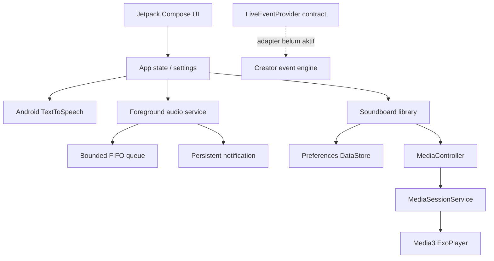

# ◈ LiveCreator Studio

<p align="center">
  
</p>

<p align="center">
  <strong>ANDROID · KOTLIN · JETPACK COMPOSE · MEDIA3</strong><br>
  <em>Creator Audio Companion — kendali TTS, soundboard lokal, dan layanan audio dalam satu studio.</em>
</p>

<p align="center">
  <a href="https://github.com/adebojel/LiveCreatorStudio/actions/workflows/android.yml"></a>
  <a href="https://github.com/adebojel/LiveCreatorStudio/releases"></a>
  
  
  
</p>

<p align="center">
  <a href="https://github.com/adebojel/LiveCreatorStudio/releases/latest/download/LiveCreatorStudio-debug.apk"><strong>⬇ DOWNLOAD APK TERBARU</strong></a> ·
  <a href="https://github.com/adebojel/LiveCreatorStudio/releases">Semua Releases</a> ·
  <a href="https://adebojel.github.io/LiveCreatorStudio/">Website proyek</a>
</p>

---

## ✦ Tentang proyek

LiveCreator Studio adalah aplikasi pendamping kreator livestream berbasis Android. Fokus saat ini adalah audio yang dapat dijalankan secara lokal: text-to-speech (TTS), soundboard, antrean ucapan, dan kontrol layanan audio melalui notifikasi Android.

> **Transparansi visual:** gambar hero di atas adalah artwork konseptual bergaya glassmorphism/neon 3D, bukan screenshot aplikasi, bukan hasil render dari perangkat, dan bukan indikator bahwa seluruh modul sudah aktif.

## ◈ Status pengembangan

| Komponen | Status |
|---|---|
| Dashboard Kotlin + Jetpack Compose | Tersedia di source |
| TTS Android lokal | Tersedia di source |
| Antrean TTS bounded FIFO | Tersedia di source |
| Foreground audio service + notifikasi | Tersedia di source |
| Soundboard Media3 / MediaSession | Tersedia di source |
| Impor audio dan pustaka paket CC0 | Tersedia di source |
| Floating Control overlay opsional | Tersedia di source; perlu QA perangkat |
| Picture-in-Picture | Dihapus dari navigasi dan manifest |
| Adapter TikTok LIVE resmi | Belum terintegrasi |
| Event chat/gift/follow/share real-time | Belum tersedia |
| AI cloud / AI lokal | Belum tersedia |
| Speech-to-text streaming | Belum tersedia |
| APK production-signed | Belum tersedia |

**Versi source:** 0.6.4 (debug release, build-183). Pengujian perangkat fisik bersifat terpisah dari CI dan belum dinyatakan lulus secara formal.

## ◈ Status rilis dan validasi 0.6.4

- **Source target:** 0.6.4 / versionCode 28.
- **CI:** pull request harus lulus `testDebugUnitTest` dan `assembleDebug`; merge ke `main` akan memicu workflow rilis otomatis.
- **APK:** gunakan tautan [APK debug terbaru](https://github.com/adebojel/LiveCreatorStudio/releases/latest/download/LiveCreatorStudio-debug.apk). Workflow juga mengunggah artifact `LiveCreatorStudio-debug-apk`.
- **Rilis saat ini:** [LiveCreator Studio build-183](https://github.com/adebojel/LiveCreatorStudio/releases/tag/build-183) telah terbit dengan APK `LiveCreatorStudio-debug.apk`.
- **Perangkat fisik:** belum dinyatakan lulus sampai checklist [DEVICE_QA_CHECKLIST.md](docs/DEVICE_QA_CHECKLIST.md) dijalankan pada ponsel Android dan hasilnya dicatat. CI tidak menguji speaker, izin overlay, notifikasi OEM, Bluetooth, atau TalkBack pada perangkat nyata.
- **Signing:** workflow saat ini menghasilkan debug APK untuk pengujian; APK production-signed / Play Store belum tersedia.

## ◈ Tahap pengembangan berikutnya

Tahap berikut berfokus pada kesiapan integrasi platform secara resmi: sinkronisasi kebijakan privasi/ketentuan dengan source 0.6.4, dokumentasi batas API TikTok, dan rancangan jalur OAuth yang aman. Katalog produk publik TikTok for Developers yang ditinjau saat ini mencakup Login Kit, Share Kit, Content Posting API, Display API, dan produk lain; katalog tersebut tidak mendokumentasikan produk publik untuk membaca event LIVE (komentar/gift/follow) secara real-time. Karena itu aplikasi tidak mengklaim konektor LIVE resmi. Lihat [roadmap integrasi](docs/TIKTOK_INTEGRATION_ROADMAP.md) dan [status integrasi](https://adebojel.github.io/LiveCreatorStudio/integration.html).

## ✧ Fitur saat ini

### 1. Text-to-speech lokal
- Menggunakan mesin Android TextToSpeech pada perangkat.
- Preview teks, pengaturan speech rate dan pitch, serta kontrol stop.
- Antrean ucapan bounded FIFO dengan kapasitas maksimum 40 item.
- Callback TTS yang sudah usang tidak boleh mengubah status playback terbaru.

### 2. Audio service dan notifikasi
- Foreground service dimulai oleh tindakan pengguna.
- Notifikasi menyediakan kontrol layanan dan pengelolaan antrean.
- Status direkonsiliasi saat aplikasi kembali ke foreground.
- Android/OEM tetap dapat membatasi layanan karena kebijakan baterai, force-stop, atau kondisi sistem.

### 3. Soundboard dan pustaka audio
- Playback menggunakan AndroidX Media3 ExoPlayer dan MediaSessionService.
- Kontrol media dapat tampil pada notifikasi media, lockscreen, headset, dan perangkat Bluetooth yang kompatibel.
- Impor audio melalui Android document picker, dengan salinan lokal di penyimpanan privat aplikasi.
- Tiga paket awal diunduh otomatis pada peluncuran pertama saat internet tersedia; pengguna juga dapat memilih paket satu per satu atau mengunduh seluruh katalog 34 paket. Katalog mencakup laugh/giggle, kiss, gunshot, thunder, applause, cartoon boing, magic poof, camera flash, dan 100 Weird & Everyday SFX. Setelah terpasang, suara dapat dipakai offline.
- Arsip ZIP dan file MP3 individual diambil langsung dari sumber CC0 saat runtime, bukan disisipkan ke APK atau disalin sebagai asset GitHub Release; sumber dan lisensi dicatat per paket. SFXMint menyatakan asetnya CC0 1.0 dan mengizinkan direct hotlink; efek dari sumber ini dibuat dengan AI/procedural synthesis.
- Pencarian, filter sumber, play/stop, serta penghapusan file impor.
- Penghapusan file dibatasi ke folder impor aplikasi agar aset paket tidak terhapus.

### 4. Floating Control
- Bola overlay glass RGB berukuran 36–64 dp, dapat digeser, lalu menempel magnetis ke sisi kiri/kanan dengan grip 16 dp tetap terlihat.
- Pintasan untuk kontrol layanan audio.
- Ukuran default diperkecil; opasitas dapat diatur dan posisi dock disimpan.
- Onboarding izin berurutan: notifikasi Android lebih dahulu, lalu penjelasan izin overlay opsional; mikrofon/kamera tidak diminta karena tidak dipakai fitur saat ini.
- Memerlukan izin overlay Android yang diberikan secara eksplisit dan nonaktif secara default.
- Tidak membaca layar, tidak mengendalikan aplikasi lain, dan bukan kontrol Quick Settings/notification shade.

### 5. Arsitektur dan kualitas
- UI Jetpack Compose dengan layanan audio terpisah dari lifecycle layar.
- Preferences DataStore dengan migrasi preferensi lama.
- Tes unit JVM untuk antrean, penyimpanan, sanitasi preferensi, katalog paket, dan kontrak event.
- GitHub Actions menjalankan `testDebugUnitTest` dan `assembleDebug`.

## ⌘ Arsitektur ringkas



## ◇ Integrasi TikTok dan AI — status yang jujur

Fondasi kontrak provider event sudah tersedia untuk memisahkan sumber event dari UI. Namun belum ada konektor TikTok LIVE runtime yang aktif. Aplikasi belum menerima event chat, gift, follow, share, atau like secara real-time dan belum menjalankan aksi otomatis berdasarkan event tersebut.

Integrasi berikutnya harus menggunakan akses/API resmi yang memang diberikan kepada aplikasi. Tidak ada scraping, cookie sesi pribadi, atau reverse-engineered connector yang diklaim sebagai integrasi resmi. Persetujuan API, batasan platform, privasi, dan kelayakan distribusi harus diperiksa sebelum rilis publik.

AI cloud, model lokal GGUF/llama.cpp, dan streaming speech-to-text juga belum terintegrasi. Ketika dikembangkan, modul tersebut harus opsional, memiliki kontrol izin, batas penggunaan resource, dan fallback yang jelas.

## ⇧ Unduh dan instalasi

- **[Unduh APK debug terbaru](https://github.com/adebojel/LiveCreatorStudio/releases/latest/download/LiveCreatorStudio-debug.apk)**
- [Buka GitHub Releases dan Assets](https://github.com/adebojel/LiveCreatorStudio/releases)
- [Lihat GitHub Actions / status build](https://github.com/adebojel/LiveCreatorStudio/actions)

APK yang diterbitkan workflow saat ini adalah **debug APK untuk pengujian**, bukan APK produksi bertanda tangan untuk Google Play. Android/Play Protect dapat menampilkan peringatan ketika memasang APK sideload. Jangan menonaktifkan perlindungan perangkat untuk mengatasi peringatan tersebut.

## ⚙ Build dari source

Persyaratan:
- JDK 17
- Android SDK 36
- Gradle 8.13 (workflow CI)
- Android Gradle Plugin dan Kotlin plugin sesuai konfigurasi proyek

Jalankan dari root repository:

```bash
gradle testDebugUnitTest assembleDebug
```

Output:

```text
app/build/outputs/apk/debug/app-debug.apk
```

GitHub Actions menjalankan tes dan build pada pull request serta push ke `main`. Setelah perubahan digabung ke `main` dan workflow berhasil, APK debug diunggah sebagai artifact dan asset GitHub Release otomatis. Release hanya boleh dianggap tersedia setelah workflow dan halaman Releases benar-benar menunjukkan hasil sukses.

## ◉ Dokumentasi proyek

| Dokumen | Keterangan |
|---|---|
| [Website resmi](https://adebojel.github.io/LiveCreatorStudio/) | Beranda proyek |
| [Fitur](https://adebojel.github.io/LiveCreatorStudio/features.html) | Ringkasan kemampuan |
| [Panduan unduh](https://adebojel.github.io/LiveCreatorStudio/download.html) | Instalasi dan build |
| [Status integrasi](https://adebojel.github.io/LiveCreatorStudio/integration.html) | Batasan konektor |
| [Pusat bantuan](https://adebojel.github.io/LiveCreatorStudio/support.html) | Bantuan pengguna |
| [Kebijakan privasi](https://adebojel.github.io/LiveCreatorStudio/privacy.html) | Privasi |
| [Ketentuan layanan](https://adebojel.github.io/LiveCreatorStudio/terms.html) | Ketentuan |
| [Audit repository](docs/REPOSITORY_AUDIT.md) | Evaluasi proyek eksternal dan lisensi |
| [Katalog soundboard](docs/SOUND_LIBRARY.md) | Sumber dan lisensi aset audio |
| [Checklist QA perangkat](docs/DEVICE_QA_CHECKLIST.md) | Pengujian manual Android |
| [TikTok review readiness](docs/TIKTOK_REVIEW_READINESS.md) | Persiapan integrasi/review |

## ▣ Batasan Android dan keamanan

- Android dapat menghentikan atau membatasi service; `START_STICKY` bukan jaminan berjalan tanpa henti.
- Overlay memerlukan izin khusus dan tidak dapat menggantikan kontrol sistem Android.
- Aplikasi tidak memasang AccessibilityService untuk mengendalikan aplikasi lain.
- Jangan pernah memasukkan password, cookie, access token, atau kredensial pribadi ke issue, log, README, atau chat.
- API key dan signing key untuk rilis produksi harus disimpan sebagai GitHub Actions Secrets, bukan di repository publik.
- Lisensi proyek utama belum ditetapkan. Periksa lisensi masing-masing dependency dan aset sebelum redistribusi.

## ⇢ Roadmap gabungan

1. Perkuat lifecycle TTS, playback, import/delete, dan migrasi data dengan tes yang relevan.
2. Lanjutkan QA perangkat untuk notifikasi, audio focus, lockscreen, Bluetooth, overlay, dan konsumsi baterai.
3. Implementasikan adapter LIVE hanya setelah jalur akses resmi dan persetujuan platform tersedia.
4. Kembangkan modul AI/STT opsional dengan fallback offline dan kontrol resource.
5. Siapkan signing release, privacy/compliance review, dan distribusi publik setelah seluruh validasi selesai.

---

<p align="center">
  <strong>LiveCreator Studio</strong><br>
  <sub>Built for creator workflows · Android · Open development</sub>
</p>
